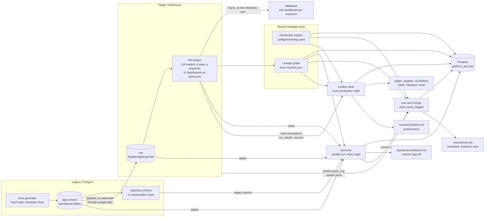

# data-platform-ops

A data platform team is usually judged on three things it only half controls: what the warehouse costs, how fast broken data gets fixed, and whether a migration can be signed off. All three depend on the same missing piece, which is knowing who owns each dataset and what depends on it. Without that, the bill lands on whoever builds the shared tables, alerts page whoever wrote the last model in the chain, and a migration is approved on a spot check and a hope.

This toolkit builds that missing piece once, as a shared metadata layer (an ownership registry and a lineage graph), and puts three modules on top of it:

- **cost** charges every query to exactly one team, under both cloud pricing styles, and finds the waste;
- **incidents** turns a storm of failing data tests into one incident per root cause and pages the person who can fix it;
- **reconcile** proves, row by row, what a migration got wrong, cheaply enough to run every night.

Everything runs on a laptop against a simulated company of five teams and about 120 dbt models, offline, from one command.

## Where the project stands: version 2.0 in progress

Version 1.x (up to [`v1.2.0`](https://github.com/nguyenngocthien0206/data-platform-ops/tree/v1.2.0)) ran the simulated company on DuckDB, with the three modules complete. Version 2.0 rebuilds that company to look like the real one the toolkit is meant for: its reporting runs on a **legacy Postgres** as hand-written SQL, and it is **migrating to self-managed ClickHouse**, where the analytics become one dbt project. Each module then moves onto that migration, one phase at a time.

| Piece | On `main` today | Phase |
|---|---|---|
| Legacy Postgres, its 12 hand-written reports | running | 11a, done |
| Incremental ingestion into ClickHouse | running | 11a, done |
| The dbt project on ClickHouse | running | 11a, done |
| Ownership check and lineage | running, results in the Postgres ops store | 11a, done |
| Metabase dashboards built from the exposures, one ClickHouse user per team | running | 11b, done |
| Reconciliation: a six-week parallel run, tables and reports every night, and the cutover sign-off | running | 12, done |
| Cost and FinOps on ClickHouse's query log: the cluster's bill per team, the migration's business case, BigQuery and Snowflake on the same workload | running | 13a, done |
| The Streamlit dashboards on the ops store, read as their own read-only role | running | 13b, done |
| Incidents on the company's production runs: faults in operation, every night's invocations ingested, one incident per root, resolved by a later run | running | 14a, done |
| Incidents from real Airflow (Cosmos) and Dagster runs: the hooks they call, a namespace each, a chat double ([orchestrators](orchestrators/README.md)) | Airflow 3 with Cosmos running, tested end to end on demand; Dagster follows | 14b |
| Documentation and release 2.0.0 | | 15 |

Every 1.x module now runs on the new company; `make paused` confirms none is left. To run the complete 1.x toolkit, check out `v1.2.0` and follow its README. The full plan is in [docs/SPEC.md](docs/SPEC.md), and [docs/PROGRESS.md](docs/PROGRESS.md) records every decision and measurement along the way.

## Architecture



The company has no change data capture, like many teams at the start of a migration, so an ingestion job pulls new and changed rows by an `updated_at` watermark and re-reads an hour before it to catch late commits. Raw tables in ClickHouse are `ReplacingMergeTree`, so a row read twice or changed in place keeps only its latest version. Staging reads them as views; every other model is a `MergeTree` table sorted by its own key, and the four large event tables rebuild only their last two monthly partitions. Those engine and key choices are made per layer and written down, because they decide what every team's queries cost once Phase 13 prices them, and a sort key chosen by the platform team is paid for by whoever reads the table.

Nobody queries ClickHouse as an admin. Each team has its own user, and so do Metabase, dbt and the ingestion: the business teams and Metabase read only the marts, dbt owns the databases it builds, and the loader may only write raw ([ADR 0016](docs/adr/0016-users-per-team-and-bi-from-exposures.md)). The query log therefore records who ran every query, which is what Phase 13 needs to show each team its own load. Metabase's dashboards are generated from the dbt exposures, one per exposure in its owning team's collection, so adding a dashboard means adding an exposure and goes through the same review as the models it reads.

The last six weeks of the company's window are the migration's **parallel run**: both systems run, dbt builds every night, and every night the 9 operational tables and the 12 legacy reports are compared with ClickHouse, with a segmented checksum diff that only opens the segments that differ ([ADR 0017](docs/adr/0017-the-parallel-run-and-the-cutover-rule.md)). The copy job runs as the migration team first delivered it, with four defects nobody has noticed yet, until a week into the parallel run; one-off faults follow and are repaired the next day. A report that differs is explained through dbt's lineage by a table that differs the same night, or it is a logic difference between the old SQL and the new. The cutover is recommended only after fourteen clean nights in a row, which is how a data owner actually signs a migration off.

The modules still never talk to each other. They share the registry and the lineage graph and write their results to the `ops` schema of a separate Postgres database, which is also where incidents will live once they run against the company's real dbt jobs. Every place a real deployment talks to an outside system sits behind a small interface with a local default ([ADR 0010](docs/adr/0010-local-first-design.md)).

## Quickstart

You need [uv](https://docs.astral.sh/uv/), Docker, GNU make and a machine with 16 GB of memory.

On Windows, install [Git for Windows](https://git-scm.com/download/win) and GNU make (`winget install ezwinports.make`). The Makefile runs its recipes with Git's bash, so `make` works the same from PowerShell, cmd or Git Bash; if Git is not in `C:/Program Files/Git`, pass its bash as `make GIT_BASH="<path>/bin/bash.exe" <target>`.

```bash
cp .env.example .env      # local passwords for Postgres and ClickHouse
make setup                # Python dependencies
make up                   # Postgres (legacy and ops store) and ClickHouse
make demo                 # the company's 112 days: parallel run, production, every module
make reconcile            # the cutover sign-off, reports/reconciliation.md
make incidents            # the production weeks' incidents, reports/incidents.md
make cost                 # who spends what on ClickHouse, reports/cost.md
make dashboard            # the toolkit's results on http://localhost:8501
make metabase             # the company's BI on http://localhost:3000, 12 dashboards
make paused               # any 1.x module not moved yet (none since Phase 14)
make test                 # unit and integration tests
```

`make demo` seeds the legacy Postgres with a year of history, then replays 112 simulated days: each day's orders, payments, sessions and in-place changes reach Postgres, the ingestion pulls them into ClickHouse at 02:00, dbt builds the project on ClickHouse every four weeks, and Metabase's dashboards and a few people's ad hoc SQL read it, each under their own ClickHouse user. Six weeks are the parallel run: dbt builds every night and the migration is reconciled every night. The last three are production on ClickHouse: every night runs dbt's freshness, run, snapshot and test, eight faults happen in operation, and the incident desk ingests each invocation, pages the owner and resolves each incident once a later run finds its root healthy. It starts from scratch every time, so two runs leave identical data on both servers and write the same sign-off. Afterwards, the legacy reports are in Postgres (`reporting` schema of the `legacy` database), the marts in ClickHouse (`marts` database, HTTP on port 8123), the ownership, lineage, reconciliation, incident and cost tables in the `ops` schema of the `platform_ops` database, and the sign-off, the incident report and the cost report in `reports/`.

`make metabase` starts Metabase (a separate, heavier service that `make demo` does not need), then builds its dashboards from the exposures; log in with `MB_ADMIN_EMAIL` and `MB_ADMIN_PASSWORD` from `.env`. It can be run again at any time and makes Metabase match the project.

`make test` and `make lint` also run natively; without the servers up, the tests that need them skip with the reason.

## Run it in Docker

The same demo with nothing on the host but Docker and GNU make (plus Git for Windows on Windows, see above): no Python, no uv, and no dependence on the host's security policies ([ADR 0012](docs/adr/0012-the-toolkit-in-a-container.md)).

```bash
cp .env.example .env
make docker-build         # the toolkit image; the first build downloads the dependencies
make docker-demo          # Postgres and ClickHouse up, then the demo from a clean state
make docker-test          # the full suite, skips listed with their reason
make docker-metabase-check  # after docker-demo: every dashboard provisioned, run and opened in a browser
make airflow              # Airflow 3 with Cosmos on its own company, UI on localhost:8080
make docker-test-orchestrators  # a fault through Airflow: its incident, page, fix and resolution
```

`make docker-lint` and `make docker-metadata-check` run the same checks as CI ([ADR 0013](docs/adr/0013-ci-and-release-from-the-same-container.md)). The company's data lives in the Postgres and ClickHouse volumes, the toolkit's scratch state on its own volumes; `make docker-clean` removes the latter, and `make help` lists every target.

## Version 2.0 so far

From the verification of each phase at the default scale, in the container on one laptop. These numbers come from the console and the database, not from a report file, and every one of them is recorded in [docs/PROGRESS.md](docs/PROGRESS.md).

**The company runs, and repeats itself exactly.** Since Phase 14, `make docker-demo` took 56 minutes 11 seconds and 57 minutes 17 seconds from a clean state, most of it the parallel run's nightly builds and checks and the production weeks' nightly freshness, run, snapshot and test (45 minutes in Phase 13, 4 minutes 35 seconds before the parallel run). It seeds 3,507,804 rows of history into Postgres, then over 112 days adds 2,427,173 rows and changes 4,259 in place, ingests 15,521,421 rows into ClickHouse (the fixed job's backfill reloads everything once, each production fix resyncs its table, and the overlap window re-reads a margin on purpose), and runs 65 dbt builds. Two clean runs left 195 of 196 relations and grants identical: every ClickHouse table and view, every legacy table and report, every ops table but the run's own random id (and dbt's invocation ids in the incident store), every user's grants, and the sign-off, the incident report, its postmortems and the cost report byte for byte. That repeatability is what lets a cost or a sign-off be put on a number and reproduced by a reviewer.

**Ownership moved with the project.** All 141 datasets of the ClickHouse project have exactly one owner: 9 sources, 118 models, 12 exposures, the seed and the snapshot. The lineage graph has 376 edges. The same check runs on a company dbt repository's manifest in its own CI ([ADR 0014](docs/adr/0014-the-ownership-gate-in-the-consuming-repository.md)), so moving the warehouse did not reopen the question of who answers for each table.

**The old and new reports already have to agree.** Each of the 12 legacy reports is tested against the dbt mart that replaces it, row count and every numeric total, at the test scale. The first comparison caught averages a few cents off: ClickHouse's `avg` returns a float and rounds a half to even, while the legacy Postgres rounds an exact value half away from zero. A finance user comparing the old revenue report with the new dashboard would have found it in the first week of the parallel run, so the marts now compute averages the legacy way. Phase 12 turns this test into the nightly sign-off of the cutover.

**The BI is built from the project, and checked in a browser.** The 12 exposures became 12 Metabase dashboards with 69 cards in four team collections. On the development laptop Metabase took 68 seconds to become healthy, provisioning took 21 seconds, and the check ran every card through Metabase without an error, then opened every dashboard in headless Chromium. The first screenshots caught a chart that a passing query would not: a year of daily orders by country is about 4,600 rows, and Metabase draws only the first 2,000, so the line simply stopped in July. Daily charts now show the last 91 days, and the check fails any chart that reaches the limit.

**The migration is signed off the way a data owner would sign it.** Over the 42-night parallel run, the delivered job failed its first compared night with 476,961 shifted timestamps, 26,335 amounts a cent short, 351 trimmed emails and 74 lost sessions, all found and classified. The fixed job shipped a week later, seven one-off faults were each found the night they landed, and the cutover was recommended on 2026-03-30, after 14 clean nights in a row. Across the run, 3,576,917 planted discrepancies were all detected and correctly classified, no report differed without a cause in its upstream tables, and on matching nights the segmented diff moved 11,200 rows instead of 378,892,260. Building the comparison had already found two places where the new marts disagreed with the legacy reports (a ratio truncated instead of rounded, and 0 where the old report said "none"), which is the kind of thing a finance user would otherwise have found in the first week after cutover ([reconcile](src/platform_ops/reconcile/README.md)).

**The bill is split the way finance can check it.** The cluster's stated cost over the 112 days, $1,197.24 at public list prices for one node and 500 GB, is shared out by the bytes each of 34,207 queries read and the size of each table, and the shares add up to it exactly. Each query is tagged with who ran it and why, so a dashboard refresh lands on the dashboard's owner and an ad hoc query on the person's team. What the split shows is not what a team would guess: 844 ad hoc queries took $148.51 of the cluster and 12,544 dashboard refreshes $3.34, while on Snowflake the same dashboards would cost $206.64 in idle warehouse time. The nightly merge of raw, which makes those reads repeat between runs, is about a fifth of the compute, and the first line to make cheaper. The migration retires a reporting replica of $577.50 a month for a cluster of $320.32, and the saving pays back the cost of running both until cutover in 3.5 months ([cost](src/platform_ops/cost/README.md), [ADR 0018](docs/adr/0018-finops-on-a-self-managed-clickhouse.md)).

**The results are on a page, read the way the BI is.** The Streamlit app shows the run, the bill and the parallel run night by night, reading the ops store as its own read-only role, the same rule the company's ClickHouse users follow: nobody reads as the admin. It recomputes nothing; everything the cost report states is stored for it. A headless browser opens all four pages in both themes after a demo, and its screenshots caught three things no assertion would have, from a caption that turned two dollar amounts into a formula to grid labels Vega silently dropped ([dashboards](dashboards/README.md)).

**One page per problem, and the schedule sets how fast it closes.** In the three production weeks, eight faults in operation failed 34 checks, and the incident desk turned them into 8 incidents and 8 pages, each to the person who owns the broken feed: right 8 times out of 8, against 3 for paging whoever owns the failing model. Without grouping one engineer would have been paged 28 times for two problems. The numbers also show where the load piles up (6 of the 8 pages go to the one person who owns most feeds) and what sets MTTR: owners fixed within hours, but nothing resolves until the next nightly run finds the root healthy, so no incident closed in less than 24 hours. A rerun after a fix would cut that more cheaply than faster people ([incidents](src/platform_ops/incidents/README.md), [ADR 0019](docs/adr/0019-incidents-on-the-companys-production-runs.md)).

**Incremental pays only where the layout lets it.** At this size an incremental build takes about as long as a full refresh, because about 290 dbt nodes of fixed overhead dominate. Bytes read tell the real story: the two incremental marts read 63% less in their last build than in their first, while the two incremental intermediate models read more with every build, because they filter staging views over raw, and raw is sorted by its key, not by date. An `incremental` setting is a promise; the sort key decides whether ClickHouse keeps it.

## Results (1.x, at `v1.2.0`)

From `make demo` of version 1.x, on DuckDB, at the default scale: a 91-day simulated window for cost, three simulated weeks for incidents, and a year of legacy data for the migration. They stay true for `v1.2.0`, and Phase 15 replaces them with 2.0's own results.

The latest clean runs took 7 minutes 49 seconds natively and 7 minutes 16 seconds in the container, on the same laptop, with byte-identical reports. <!-- readme-check: runtime -->

**Cost: the bill is idle warehouses, not dead tables.** Thirteen weeks of dbt runs, dashboard refreshes and ad hoc SQL cost $296.02 under warehouse (compute) pricing and $3.35 under on-demand scan pricing. Dashboards alone are $167.90 against $0.6514, because every refresh wakes the BI warehouse for seconds of work and minutes of idling: 99% of its billed time is idle. The 12 abandoned models the project plants are found exactly, and together cost almost nothing. For a platform lead, that changes the conversation with the business teams from "delete your old tables" to "refresh your dashboards less often, or move them to a shared warehouse", and showback makes each team see its own share: platform, which builds every shared layer, is the cheapest team under compute pricing at $26.56 and the most expensive under scan pricing at $0.8314.

**Incidents: routing matters more than grouping.** Eight planted faults failed 18 checks, which became 8 incidents and 8 pages, 56% fewer pages than one per failing check. The bigger win is who gets them. Paging whoever owns the failing node sends 13 of the 18 alerts to marco, who owns the staging models, and gets the person right 3 of 8 times. Paging the owner of the source when a staging model fails gets it right 8 of 8 times and moves the load to priya, who owns the feeds, from 1 alert to 6 pages. Every fault was detected at the first nightly run it could be (16.0 hours after it landed), except the stale source, which freshness only flags after two days.

**Migration: not signed off, and the diff says why.** The delivered migration job fails the sign-off thresholds on every table. The segmented checksum diff found all 199,465 planted discrepancies and named the right cause for each: a daylight saving bug that shifts 195,478 payments by an hour, a float cast that rounds 1,434 large orders, trimmed padding on 2,497 company names, and 12 orders lost at batch boundaries. With those defects fixed, only 44 one-off discrepancies remain, and the diff saves between 90.443% and 99.358% of the rows a full comparison would move, which is what makes nightly verification of a large migration affordable rather than a one-off before cutover.

Detail, and what each number means, is in the module READMEs: [cost](src/platform_ops/cost/README.md), [incidents](src/platform_ops/incidents/README.md), [reconcile](src/platform_ops/reconcile/README.md), [metadata](src/platform_ops/metadata/README.md), [simulation](src/platform_ops/simulation/README.md) and [dashboards](dashboards/README.md).

## How the decisions were made

Each choice that shapes a number is recorded, with what it costs ([index](docs/adr/README.md)):

| ADR | Decision |
|---|---|
| [0001](docs/adr/0001-postgres-as-default-legacy-source.md) | Postgres as the default legacy source, SQL Server behind a profile (superseded in 2.0) |
| [0002](docs/adr/0002-ownership-resolution-and-platform-team.md) | Most specific ownership rule wins; the platform team owns the shared layers |
| [0003](docs/adr/0003-source-freshness-on-simulated-time.md) | Source freshness on simulated time |
| [0004](docs/adr/0004-deterministic-data-generation.md) | Deterministic data generation |
| [0005](docs/adr/0005-scan-estimate-and-modelled-compute-time.md) | Bytes from logical sizes, compute time from a model (superseded in 2.0) |
| [0006](docs/adr/0006-pricing-models-and-attribution.md) | Pluggable pricing, each query charged exactly once |
| [0007](docs/adr/0007-simulated-workload-real-builds-daily-replay.md) | Real dbt builds every four weeks, daily runs replayed (superseded in 2.0) |
| [0008](docs/adr/0008-incident-grouping-severity-and-routing.md) | Incident grouping, severity and routing |
| [0009](docs/adr/0009-cross-engine-hashing-and-canonicalization.md) | Cross-engine hashing and canonicalization |
| [0010](docs/adr/0010-local-first-design.md) | Local first, every external system behind an interface |
| [0011](docs/adr/0011-module-boundaries-and-a-review-before-release.md) | Module boundaries pinned by a test, and a review before the release |
| [0012](docs/adr/0012-the-toolkit-in-a-container.md) | The toolkit in a container, with its state on volumes |
| [0013](docs/adr/0013-ci-and-release-from-the-same-container.md) | CI and release from the same container, the tag pushed by a person |
| [0014](docs/adr/0014-the-ownership-gate-in-the-consuming-repository.md) | The ownership gate runs in the consuming repository, on its manifest |
| [0015](docs/adr/0015-clickhouse-modelling-and-watermark-ingestion.md) | ClickHouse modelling per layer, and ingestion by watermark |
| [0016](docs/adr/0016-users-per-team-and-bi-from-exposures.md) | One ClickHouse user per team, and the BI built from the dbt exposures |
| [0017](docs/adr/0017-the-parallel-run-and-the-cutover-rule.md) | The migration is signed off by a parallel run, inside the company's own history |
| [0018](docs/adr/0018-finops-on-a-self-managed-clickhouse.md) | FinOps on a self-managed ClickHouse: the stated bill shared out by measured reads |
| [0019](docs/adr/0019-incidents-on-the-companys-production-runs.md) | Incidents on the company's own production runs, from a store any run can feed |
| [0020](docs/adr/0020-orchestrators-call-the-toolkit.md) | Orchestrators call the toolkit through its CLI, each in its own image and namespace |

## Repository layout

```
config/            settings, teams and the ownership registry
dbt/               the company's dbt project on ClickHouse
src/platform_ops/  common, metadata, simulation (the company, its legacy Postgres and
                   the ingestion), cost, incidents, reconcile, dashboard
dashboards/        the Streamlit app over the ops store
scripts/           vendor fixtures, README check, browser checks of the dashboards and of
                   Metabase, the orchestrator check, release notes
tests/             unit, integration and contract tests
examples/          a GitHub Actions ownership check for a company dbt repository
orchestrators/     how Airflow (Cosmos) and Dagster hand their dbt runs to the incident desk,
                   the Airflow stack (its image and DAG), and a chat double for their tests
docs/              SPEC, PROGRESS, the ADRs and the Phase 6 review record
.github/workflows/ CI, the release, and the orchestrator check on demand
Dockerfile         the toolkit image; docker-compose.yml runs it next to Postgres, ClickHouse
                   and, behind profiles, Metabase, Airflow and the chat double
```

The build plan is in [docs/SPEC.md](docs/SPEC.md), [docs/PROGRESS.md](docs/PROGRESS.md) records what was decided along the way and why, and [CHANGELOG.md](CHANGELOG.md) lists what each release contains.
