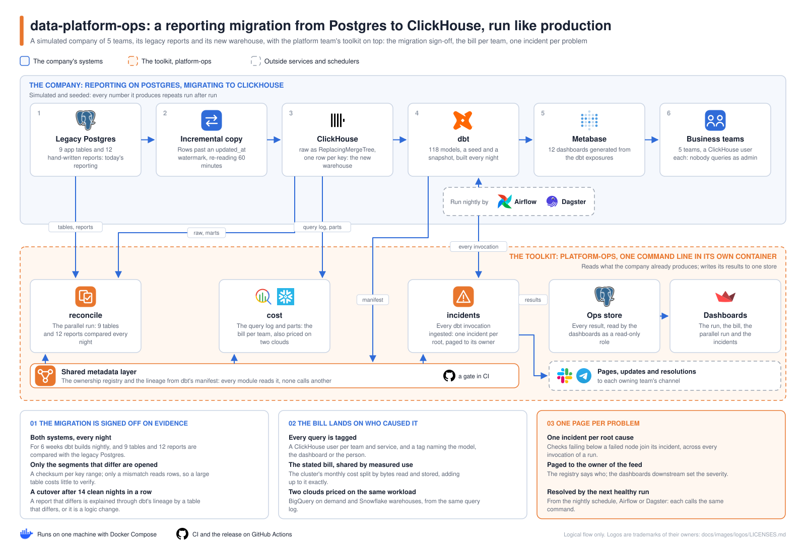
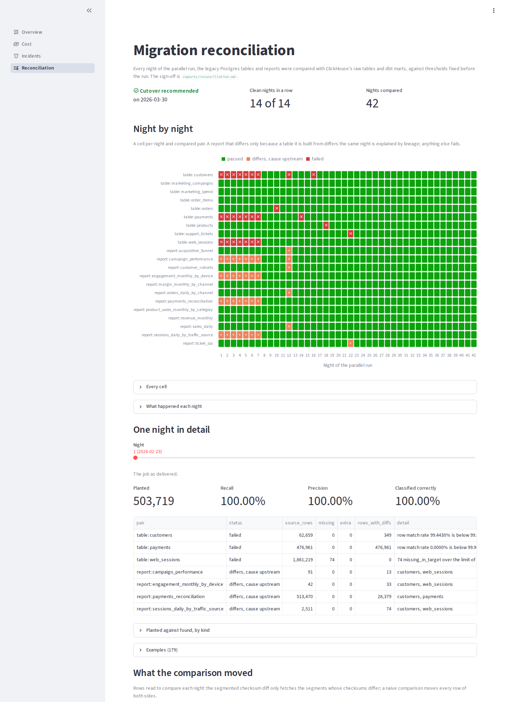
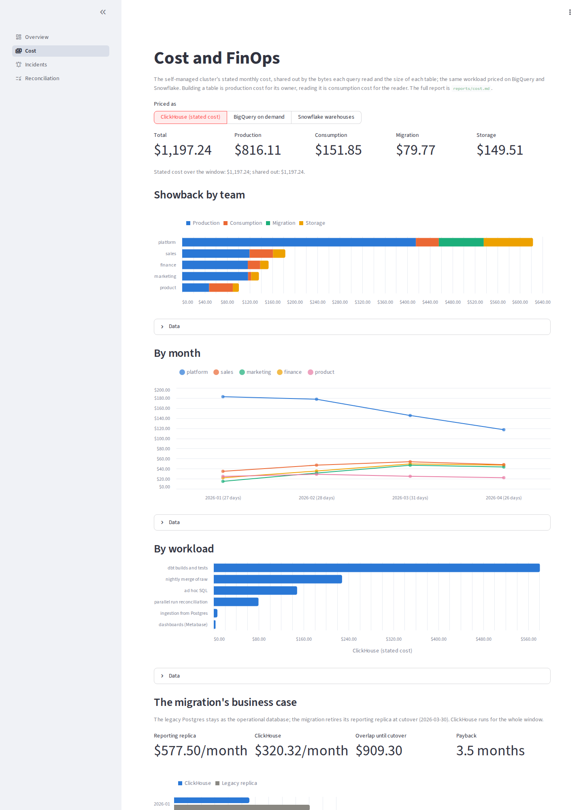
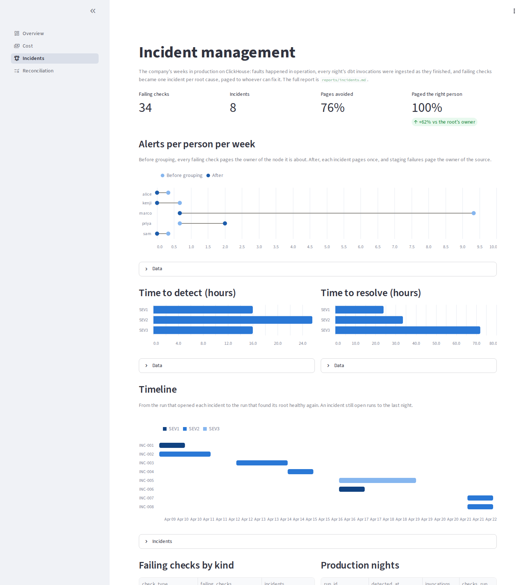
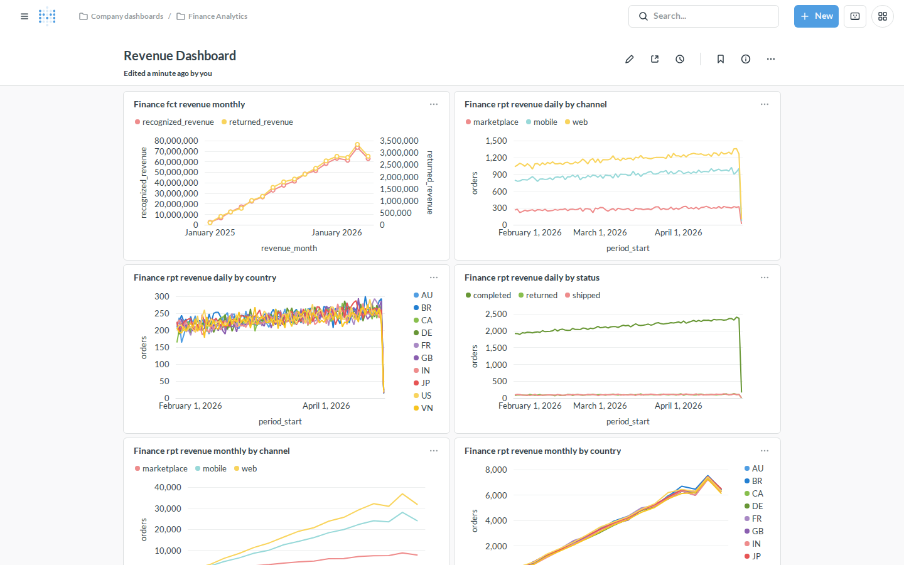
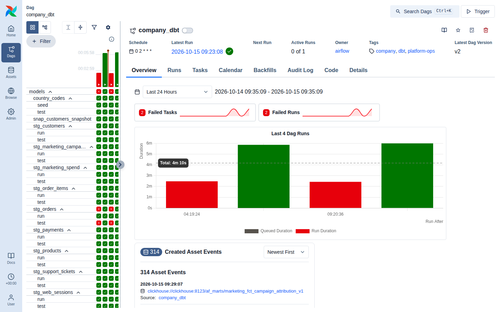
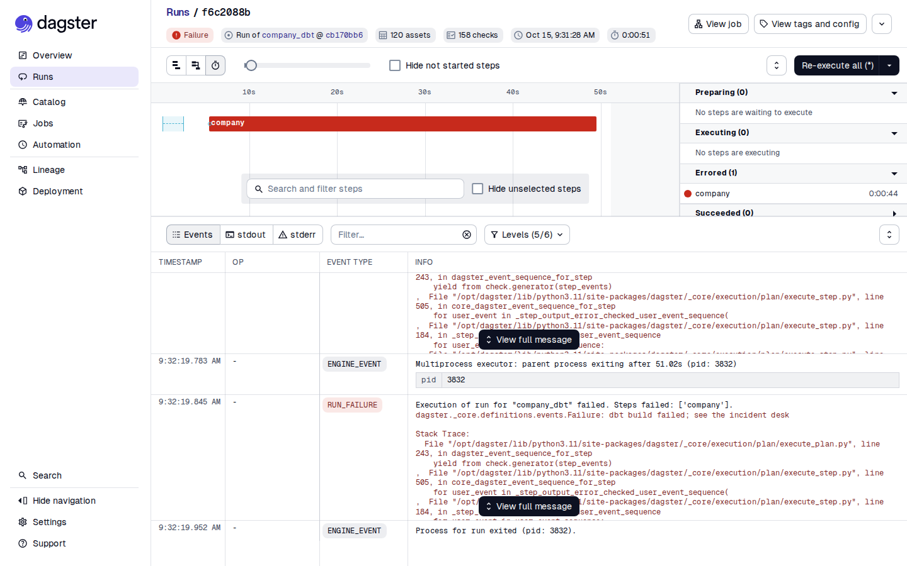

# data-platform-ops

A data platform team is judged on things it only half controls. Can the old reporting system be switched off, and who signs that? What does the new warehouse cost, and which team should see the bill? When a feed breaks at 2 a.m., who gets woken up, and how many times? The answers usually depend on one unglamorous piece of work nobody owns: knowing who owns each dataset and what depends on it.

This repository works through all three questions on one company. Its reporting runs on a **legacy Postgres** as hand-written SQL, and it is **migrating to self-managed ClickHouse**, with the analytics rebuilt as one dbt project. On top sits the toolkit a platform team would build for that move: an ownership registry and a lineage graph that everything else reads, a **reconciliation** that signs the migration off night by night, a **cost** model that splits the cluster's bill by team, and an **incident desk** that turns a storm of failing tests into one page for the right person.

The company is simulated so it can run on a laptop, offline, from one command, with five teams, a year of history and about 120 dbt models. Everything is seeded, so every number below repeats run after run.



## How it fits together

**The company (steps 1 to 6).** The business's reporting today is 12 hand-written SQL reports over the operational tables of a legacy Postgres. The company has no change data capture, like many teams at the start of a migration, so an incremental copy pulls new and changed rows into ClickHouse by an `updated_at` watermark, re-reading an hour before it to catch late commits. Raw tables in ClickHouse are `ReplacingMergeTree`, so a row read twice or changed in place keeps only its latest version. dbt builds the new analytics on top, every four weeks at first and every night once the migration's parallel run starts, run by the company's own schedule or by Airflow or Dagster. Metabase's 12 dashboards are generated from the dbt exposures, and every team, service and tool queries ClickHouse as its own user: nobody uses the admin account.

**The migration window.** The company's 112 days end with its migration: six weeks of a **parallel run**, where both systems run and are compared every night, and the cutover once the comparison has been clean for 14 nights in a row; then three weeks of **production** on ClickHouse alone, where faults happen the way they do in real life.

**The toolkit.** Three modules read what the company already produces and never call each other. They share one metadata layer, the ownership registry and the lineage graph, and write every result to one store, a separate Postgres database that the Streamlit dashboards read through a read-only role. **reconcile** compares Postgres and ClickHouse table by table and report by report. **cost** reads ClickHouse's own query log and storage tables. **incidents** reads each dbt invocation's results, from the nightly schedule, Airflow or Dagster alike, and pages the owner, in Slack or Telegram once their tokens are set. Every place a real deployment talks to an outside system sits behind a small interface with a local default ([ADR 0007](docs/adr/0007-local-first-design.md)). [How it works](docs/HOW-IT-WORKS.md) explains each module step by step, starting from the simplest approach and adding one idea at a time.

## What it looks like

The toolkit's own pages, read from the ops store. The parallel run, night by night, and the cutover it recommends:



The cluster's bill shared out by team, and the same workload priced on BigQuery and Snowflake:



The production weeks' incidents, one per root cause, and who was paged:



The company's BI, generated from the dbt exposures, here the finance team's revenue dashboard:



A fault through the two schedulers: Airflow runs one task per dbt model, so the failed test is one red cell among hundreds; Dagster runs one build and fails the run once the incident desk has it.

<p>
  
  
</p>

## Results

From the 2.0.0 release run: two runs of `make docker-demo` from a clean state at the default scale, then the Metabase and orchestrator checks, in the container on one laptop. Every number is recorded in [docs/PROGRESS.md](docs/PROGRESS.md).

**The company runs, and repeats itself exactly.** `make docker-demo` took 52 minutes 30 seconds and 51 minutes 57 seconds from a clean state, most of it the parallel run's nightly builds and checks and the production weeks' nightly freshness, run, snapshot and test. It seeds 3,507,804 rows of history into Postgres, then over 112 days adds 2,427,173 rows and changes 4,259 in place, ingests 15,521,421 rows into ClickHouse (the fixed job's backfill reloads everything once, each production fix resyncs its table, and the overlap window re-reads a margin on purpose), and runs 65 dbt builds. Two clean runs left 195 of 196 relations and grants identical: every ClickHouse table and view, every legacy table and report, every ops table but the run's own random id (and dbt's invocation ids in the incident store), every user's grants, and the sign-off, the incident report, its postmortems and the cost report byte for byte. That repeatability is what lets a cost or a sign-off be put on a number and reproduced by a reviewer. <!-- readme-check: console -->

**The migration is signed off the way a data owner would sign it.** Over the 42-night parallel run, the delivered copy job failed its first compared night with 476,961 shifted timestamps, 26,335 amounts a cent short, 349 trimmed emails and 74 lost sessions, all found and classified. The fixed job shipped a week later, seven one-off faults were each found the night they landed, and the cutover was recommended on 2026-03-30, after 14 clean nights in a row. Across the run, 3,576,911 planted discrepancies were all detected and correctly classified, no report column differed without a cause in the upstream columns it reads, and on matching nights the segmented diff moved 11,200 rows instead of 378,885,458 ([reconcile](src/platform_ops/reconcile/README.md)).

**The bill is split the way finance can check it.** The cluster's stated cost over the 112 days, $1,197.24 at public list prices for one node and 500 GB, is shared out by the bytes each of 35,175 queries read and the size of each table, and the shares add up to it exactly. What the split shows is not what a team would guess: 844 ad hoc queries took $143.76 of the cluster and 12,544 dashboard refreshes $3.24, while on Snowflake the same dashboards would cost $206.64 in idle warehouse time. The migration retires a reporting replica of $577.50 a month for a cluster of $320.32, and the saving pays back the cost of running both until cutover in 3.5 months ([cost](src/platform_ops/cost/README.md)).

**One page per problem.** In the three production weeks, eight faults in operation failed 39 checks, and the incident desk turned them into 8 incidents and 8 pages, each to the person who owns the broken feed: right 8 times out of 8, against 4 for paging whoever owns the failing model. Without grouping, one engineer would have been paged 27 times for two problems. Every fault was caught by the first nightly run after it happened, a stopped feed included, and each incident closed the moment its fix landed, because the root and everything below it are rebuilt then: a mean of 22.3 hours from detection to resolution, 7.1 for the two SEV1s ([incidents](src/platform_ops/incidents/README.md)).

**The same desk, whatever runs dbt.** A faulted night reached the incident desk as 70 separate invocations from Airflow (Cosmos runs one per model) and as two from Dagster (one build), and both gave the same answer: one incident at `stg_orders`, one page, one resolution after the fix. The same healthy build took about 6 minutes in Airflow and about a minute and a half in Dagster ([orchestrators](orchestrators/README.md)). <!-- readme-check: console -->

**Ownership moved with the project.** All 141 datasets of the ClickHouse project have exactly one owner: 9 sources, 118 models, 12 exposures, the seed and the snapshot, and the lineage graph has 376 edges ([metadata](src/platform_ops/metadata/README.md)). <!-- readme-check: console -->

**The BI is checked in a browser, not only by its queries.** The 12 exposures became 12 Metabase dashboards with 69 cards, and every card ran through Metabase without an error. The first screenshots still caught a chart a passing query would not: a year of daily orders by country is about 4,600 rows, and Metabase draws only the first 2,000, so the line simply stopped in July ([simulation](src/platform_ops/simulation/README.md)). <!-- readme-check: console -->

## How the problems were solved

Each problem below is one a platform team meets in a migration like this one. Each is told the same way: what we saw, how we framed it, what we decided and what that costs, and what the numbers then showed. The full reasoning is in the architecture decision records ([index](docs/adr/README.md)).

### A migration nobody can sign off on a spot check

**What we saw.** The usual sign-off is a row count and a few totals the week before cutover. It misses exactly what copy jobs get wrong: a time zone read wrongly, a decimal passed through a float, trailing spaces trimmed, a key lost at a page boundary. Each looks fine in a count, and each is the bug a finance user finds a month after the old system is gone.

**How we framed it.** The person who signs is a data owner, not an engineer, so the question is not "do the tables match" but "would the business see the same numbers in the new dashboards, every day, for long enough to trust it". That makes it a nightly comparison of two systems, at two levels: the operational tables (is the copy right) and the reports (does the new dashboard show what the old report showed).

**What we decided, and what it costs.** A six-week parallel run, compared every night. Every value is rendered to one canonical string in both engines and hashed, rows are summed into segments by their key, and only segments that disagree are opened, down to a few hundred rows. A report difference counts as explained only when a column it reads differs upstream the same night, traced column by column from dbt's compiled SQL; a cause label (rounding, a time zone shift) is given only when that mechanism reproduces the value. Equality rules (do trailing spaces count?) are the data owner's, written in the config and printed in the report. The cutover is recommended after 14 clean nights in a row, a rule fixed before the run starts. The price: both systems run for six weeks, and the comparison's own reads were $79.77 of the cluster's bill.

**What the numbers showed.** All four defects of the delivered job were found on the first night, all seven one-off faults the night each landed, and all 3,576,911 planted discrepancies were classified correctly. On matching nights the diff moved 11,200 rows instead of 378,885,458, which is what makes a nightly check affordable. Building the comparison also found three places where the new marts disagreed with the legacy SQL before any fault was planted: averages a few cents off (ClickHouse's `avg` rounds a half to even, the legacy Postgres away from zero), a ratio truncated instead of rounded, and 0 where the old report said "none". Each is the kind of thing a finance user would have found in the first week after cutover. ([ADR 0014](docs/adr/0014-the-parallel-run-and-the-cutover-rule.md), [ADR 0006](docs/adr/0006-cross-engine-hashing-and-canonicalization.md))

### A self-managed cluster sends one bill, not one per query

**What we saw.** Cloud warehouses price each query, so showback is a sum. A self-managed ClickHouse is a few machines and disks paid by the month. Nobody gets a bill for their query, so the cost lands on the platform team's budget, and nobody changes a habit.

**How we framed it.** The platform team's real job is to split a fixed invoice fairly enough that finance accepts it and each team recognises its own share. That needs two things: knowing who ran every query and why, and a split rule that adds up to the invoice exactly.

**What we decided, and what it costs.** One ClickHouse user per team and per service, so the query log knows who; a tag on every query naming the model, dashboard or person it was for, carried by dbt's profile and the BI's connection; and the stated monthly cost shared by bytes read (compute) and bytes stored, exact to the cent. Building and testing a table is production cost for its owner; reading it is consumption cost for the reader, so a dashboard's refreshes land on the teams that open it, shared each month by their views in the BI tool's view log, not on the BI tool's user. The price: repeatable byte counts need the raw layer merged every night, and that merge is about a fifth of the compute, the first line to make cheaper.

**What the numbers showed.** A few careless ad hoc queries cost the cluster more than all the dashboards together ($143.76 against $3.24), while on Snowflake the dashboards would be the expensive part ($206.64), so which habit to change first depends on how the warehouse is billed. The view log showed that dashboard owners pay about half of what their dashboards cost once the other teams' views are counted, and that three dashboards were refreshed for 112 days with nobody opening them; on Snowflake one of them would be the second most expensive. The migration pays for itself in 3.5 months. At this data size BigQuery on demand would cost $4.08 for the whole window, the argument a platform lead should be ready to answer before the data grows into the cluster. ([ADR 0013](docs/adr/0013-users-per-team-and-bi-from-exposures.md), [ADR 0015](docs/adr/0015-finops-on-a-self-managed-clickhouse.md), [ADR 0004](docs/adr/0004-pricing-models-and-attribution.md))

### One broken feed pages the wrong person a dozen times

**What we saw.** When a raw table goes wrong, every test downstream of it fails. Alerting on each failing test pages whoever owns those models, many times, for one problem they cannot fix.

**How we framed it.** An incident is a root cause, not a failing check, and the person to wake is the one who can fix the root. A failed node whose ancestors are all healthy is a root; everything below it is impact. A staging model that fails because its raw feed is broken belongs to whoever owns the feed.

**What we decided, and what it costs.** One incident per root, regrouped across every invocation of a run, so a run split into one invocation per model gives the same incidents as one build. Severity comes from the dashboards downstream; the page goes to the owner of the source when a staging model fails. An incident resolves only when a later run covered its root and found it healthy, and the run that confirms a fix is started by the fix: the root and everything below it are rebuilt as soon as it lands. Every continuous feed has a volume test next to its freshness rule, checked before the models are built. Everything lives in a store any dbt run can feed, through one command. The price: the store is a small Postgres schema to run, and every fix costs a rebuild of what it touched.

**What the numbers showed.** 39 failing checks became 8 incidents and 8 pages, routed right 8 times out of 8 against 4 for the naive rule, and one engineer was spared 27 pages for two problems. The routing also showed where the load piles up: 6 of the 8 pages went to the one person who owns most feeds, which is a staffing conversation, not a tooling one. Rebuilding right after each fix took the mean time to resolve from 36.0 hours (waiting for the next night) to 22.3, and the volume test caught the stopped feed after 16 hours instead of the 64 the freshness rule needed. What is left of the time to resolve is the owners' own: the SEV3 waited 60.1 hours for its fix. ([ADR 0005](docs/adr/0005-incident-grouping-severity-and-routing.md), [ADR 0016](docs/adr/0016-incidents-on-the-companys-production-runs.md))

### Ownership has to survive the migration

**What we saw.** Moving 120 models to a new warehouse is the moment ownership quietly gets lost: files move, folders are renamed, and a dataset with no owner is one whose bill and pages land on the platform team.

**How we framed it.** Ownership is code. It belongs next to the dbt project, reviewed in the same pull request as the model, and checked by CI like a test.

**What we decided, and what it costs.** A registry of teams and rules (the most specific rule wins, and the platform team owns the shared layers), checked against dbt's manifest on every pull request in the company's own repository, from the toolkit's published image, without a warehouse connection. A starter registry is generated from the manifest, so a large project starts from a short to-do list rather than a blank file. The price: someone has to close those to-dos, and the check can only be required once they are closed.

**What the numbers showed.** All 141 datasets of the ClickHouse project kept exactly one owner through the move, and the cost split and the incident routing above both read from that same registry. ([ADR 0001](docs/adr/0001-ownership-resolution-and-platform-team.md), [ADR 0011](docs/adr/0011-the-ownership-gate-in-the-consuming-repository.md))

### No change data capture

**What we saw.** The legacy database has no change stream, and adding one is a project of its own. The copy has to work from what is there: an `updated_at` column on every table.

**How we framed it.** A watermark copy loses rows that commit late with an older timestamp, and reads some rows twice. The design has to make both harmless and say how much it costs.

**What we decided, and what it costs.** Pull by watermark, re-reading a margin before it (an hour), into `ReplacingMergeTree` raw tables keyed like the source, so a row read twice or changed in place keeps only its latest version. Every later layer is modelled for how it is read: staging as views, the rest as tables sorted by their own key, the large event tables incremental by month. The price: readers need `FINAL` or a nightly merge to see one row per key, and a sort key chosen by the platform team is paid for by whoever reads the table.

**What the numbers showed.** The overlap catches late commits by design, at the cost of re-reading a margin every load. And the incremental models showed that layout matters as much as the setting: the two incremental marts read 63% less in their last build than their first, while two incremental models over raw read more every time, because raw is sorted by key, not by date. ([ADR 0012](docs/adr/0012-clickhouse-modelling-and-watermark-ingestion.md))

### Every scheduler is different

**What we saw.** Teams run dbt from Airflow with Cosmos (one task per model), from Dagster with dagster-dbt (one build per run), or from a cron line. An incident tool that only understands one of them is an incident tool most teams cannot use.

**How we framed it.** The schedulers differ in how they split a run, not in what dbt writes. If the desk regroups every invocation that shares a run id, the split stops mattering, and the scheduler only has to hand over a folder and an id.

**What we decided, and what it costs.** The schedulers call the toolkit's command line, not its library, through two small hooks written in the standard library only. Each scheduler runs in its own image, with the toolkit in a separate environment, so Airflow's, Dagster's and the toolkit's dependencies never have to agree. A failed hand-over is logged and never fails the pipeline. The price: a process start per invocation, and a second Python environment in each image.

**What the numbers showed.** One fault, 70 invocations from Airflow and 2 from Dagster, and the same single incident, page and resolution from both. The release now waits for that check to pass through both schedulers. ([ADR 0017](docs/adr/0017-orchestrators-call-the-toolkit.md))

### Numbers nobody can reproduce are not evidence

**What we saw.** A cost or a sign-off is only useful if a reviewer can run it again and get the same number. Most demos cannot: data is random, clocks are real, and a warehouse reads a different amount depending on when its background merges ran.

**How we framed it.** Every source of variation is either removed or written down. If two runs disagree, that is a bug to find, not noise to average.

**What we decided, and what it costs.** All data from one seed and a simulated clock, including source freshness; the raw layer merged every night so reads repeat; inserts written in one part per partition; and every report checked byte for byte across two clean runs. The price: a full run takes about an hour, and some realism (background merges, parallel inserts) is traded for repeatability, which the ADRs say where.

**What the numbers showed.** Two clean runs left 195 of 196 relations identical, the one exception being the run's own random id, and every report byte for byte. ([ADR 0003](docs/adr/0003-deterministic-data-generation.md), [ADR 0002](docs/adr/0002-source-freshness-on-simulated-time.md))

## Use it on your platform

The toolkit is a reference, not a packaged product: it is built and tested on the simulated company. Some of it runs on a real platform as it is; the rest is an engine with the wiring left to you, and each module's README has an **Adopting it** section that says which is which, what to lift, what to replace and the traps we hit.

| What you need | How much is ready | Start here |
|---|---|---|
| Every dbt dataset owned by a team, checked in CI | **Runs as is**, on any dbt project and adapter, from the published image | [metadata](src/platform_ops/metadata/README.md#adopting-it) |
| One incident per root cause from your dbt runs, paged to the owner | **Runs as is**: `incidents ingest` and the Airflow and Dagster hooks; the graded report is the simulation's | [incidents](src/platform_ops/incidents/README.md#adopting-it), [orchestrators](orchestrators/README.md) |
| The bill of a ClickHouse cluster shared by team, or BigQuery and Snowflake showback | **Engine to wire**: pricing, the bill split and attribution, the BigQuery and Snowflake collectors; you write the ClickHouse collection | [cost](src/platform_ops/cost/README.md#adopting-it) |
| A Postgres to ClickHouse migration signed off night by night | **Engine to wire**: catalogue-driven specs, canonical hashing, the segmented diff and the verdicts; you write the nightly loop | [reconcile](src/platform_ops/reconcile/README.md#adopting-it) |
| Watermark ingestion, a ClickHouse user per team, BI generated from dbt exposures | **Patterns to copy** | [simulation](src/platform_ops/simulation/README.md#adopting-it) |
| A results page on the ops store | **Pattern to copy**: the pages read the simulation's tables | [dashboards](dashboards/README.md#adopting-it) |

## Quickstart

You need [uv](https://docs.astral.sh/uv/), Docker, GNU make and a machine with 16 GB of memory.

On Windows, install [Git for Windows](https://git-scm.com/download/win) and GNU make (`winget install ezwinports.make`). The Makefile runs its recipes with Git's bash, so `make` works the same from PowerShell, cmd or Git Bash; if Git is not in `C:/Program Files/Git`, pass its bash as `make GIT_BASH="<path>/bin/bash.exe" <target>`.

```bash
cp .env.example .env      # local passwords for Postgres and ClickHouse
make setup                # Python dependencies
make up                   # Postgres (legacy and ops store) and ClickHouse
make demo                 # the company's 112 days: parallel run, production, every module
make dashboard            # the toolkit's results on http://localhost:8501
make metabase             # the company's BI on http://localhost:3000, 12 dashboards
make test                 # unit and integration tests
```

`make demo` seeds the legacy Postgres with a year of history, then replays 112 simulated days: each day's orders, payments, sessions and in-place changes reach Postgres, the ingestion pulls them into ClickHouse at 02:00, dbt builds the project, and Metabase's dashboards and a few people's ad hoc SQL read it, each under their own ClickHouse user. Six weeks are the parallel run, reconciled every night; the last three are production, with faults, incidents and pages. It starts from scratch every time and ends by writing the sign-off, the incident report and the cost report to `reports/`; `make reconcile`, `make incidents` and `make cost` write them again from the stored results. Afterwards, the legacy reports are in Postgres (`reporting` schema of the `legacy` database), the marts in ClickHouse (`marts` database, HTTP on port 8123), and every result in the `ops` schema of the `platform_ops` database.

`make metabase` starts Metabase (a separate, heavier service that `make demo` does not need), then builds its dashboards from the exposures; log in with `MB_ADMIN_EMAIL` and `MB_ADMIN_PASSWORD` from `.env`. `make test` and `make lint` also run natively; without the servers up, the tests that need them skip with the reason.

## Run it in Docker

The same demo with nothing on the host but Docker and GNU make (plus Git for Windows on Windows, see above): no Python, no uv, and no dependence on the host's security policies ([ADR 0009](docs/adr/0009-the-toolkit-in-a-container.md)).

```bash
cp .env.example .env
make docker-build         # the toolkit image; the first build downloads the dependencies
make docker-demo          # Postgres and ClickHouse up, then the demo from a clean state
make docker-test          # the full suite, skips listed with their reason
make docker-metabase-check  # after docker-demo: every dashboard provisioned, run and opened in a browser
make airflow              # Airflow 3 with Cosmos on its own company, UI on localhost:8080
make dagster              # Dagster with dagster-dbt on its own company, UI on localhost:3001
make docker-test-orchestrators  # a fault through each: its incident, page, fix and resolution
```

`make docker-lint` and `make docker-metadata-check` run the same checks as CI ([ADR 0010](docs/adr/0010-ci-and-release-from-the-same-container.md)). The company's data lives in the Postgres and ClickHouse volumes, the toolkit's scratch state on its own volumes; `make docker-clean` removes the latter, and `make help` lists every target. `make docs-diagram` redraws the architecture diagram from the project, and `make docker-docs-images` retakes the screenshots after a demo.

## Repository layout

```
config/            settings, teams, the ownership registry and what the reconciliation compares
dbt/               the company's dbt project on ClickHouse
src/platform_ops/  common, metadata, simulation (the company, its legacy Postgres and
                   the ingestion), cost, incidents, reconcile, integrations (the hooks
                   schedulers call), dashboard
dashboards/        the Streamlit app over the ops store
orchestrators/     Airflow (Cosmos) and Dagster (dagster-dbt) stacks running the project,
                   and a chat double for their tests
scripts/           the architecture diagram, screenshots, browser checks of the dashboards
                   and Metabase, the orchestrator check, release notes
tests/             unit, integration and contract tests
examples/          a GitHub Actions ownership check for a company dbt repository
docs/              SPEC, PROGRESS, how each module works, the ADRs and the images
.github/workflows/ CI, the orchestrator checks, and the release, which waits for both
Dockerfile         the toolkit image; docker-compose.yml runs it next to Postgres, ClickHouse
                   and, behind profiles, Metabase, Airflow, Dagster and the chat double
```

The build plan is in [docs/SPEC.md](docs/SPEC.md), [docs/PROGRESS.md](docs/PROGRESS.md) records what was decided along the way and why, and [CHANGELOG.md](CHANGELOG.md) lists what each release contains.
